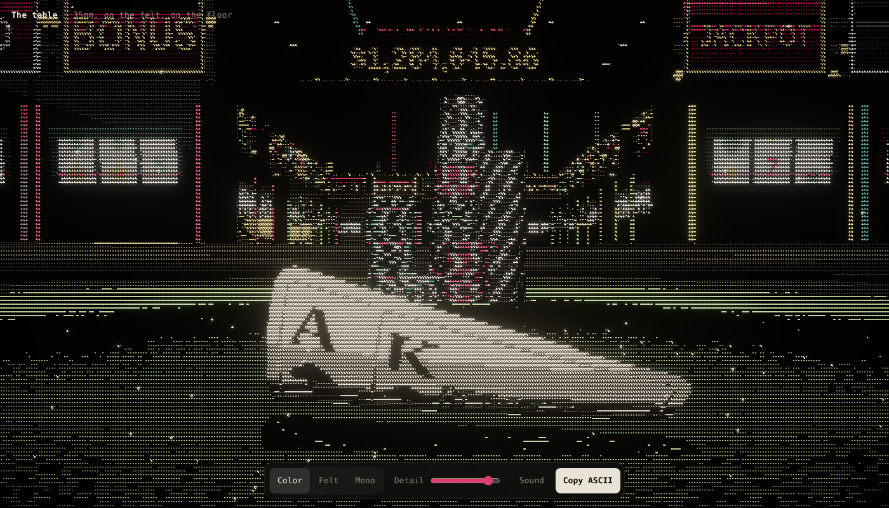
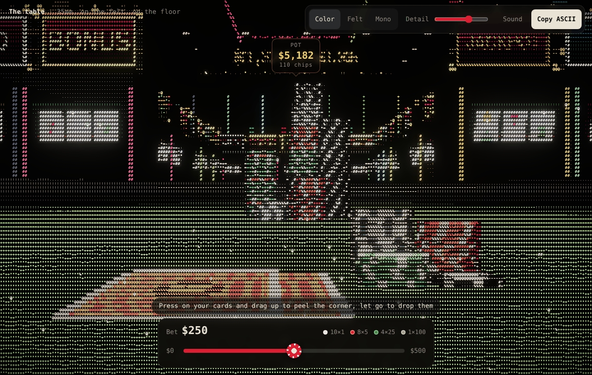
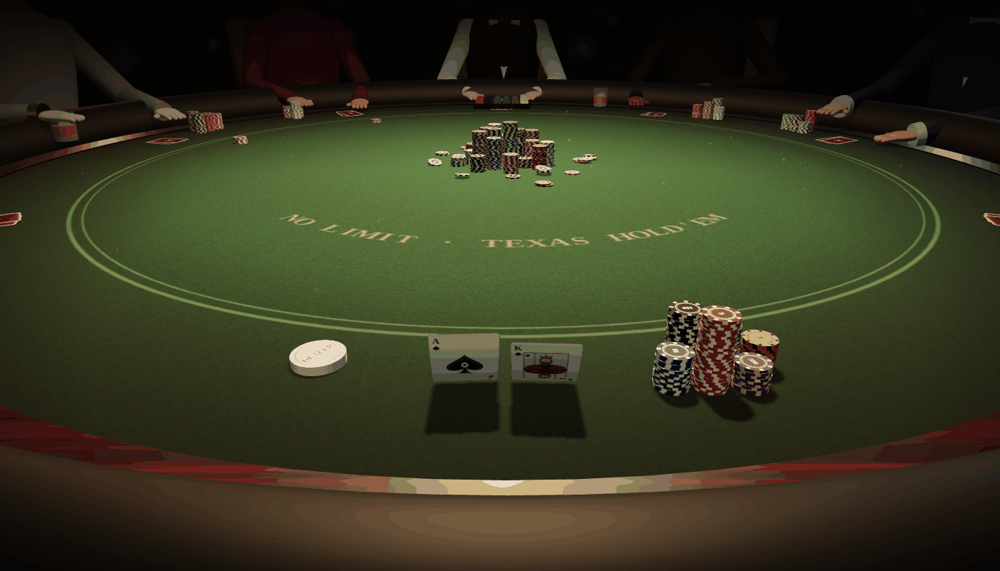
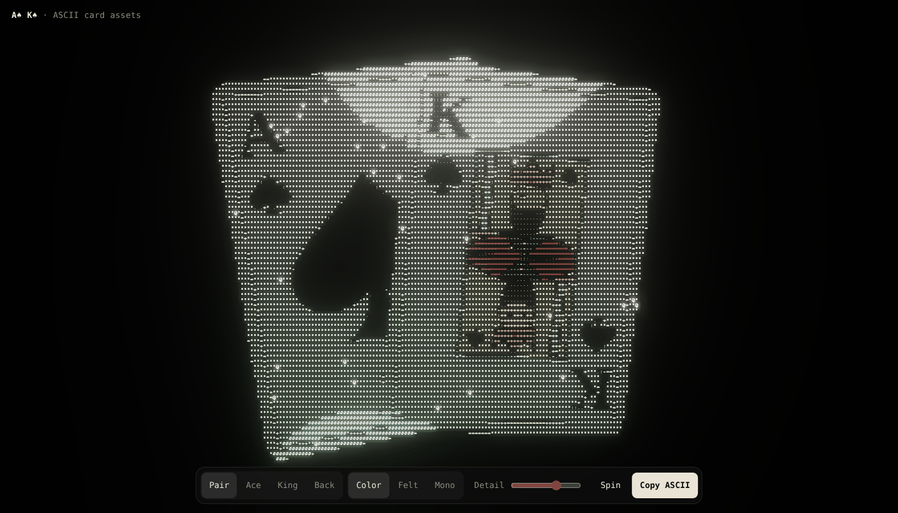
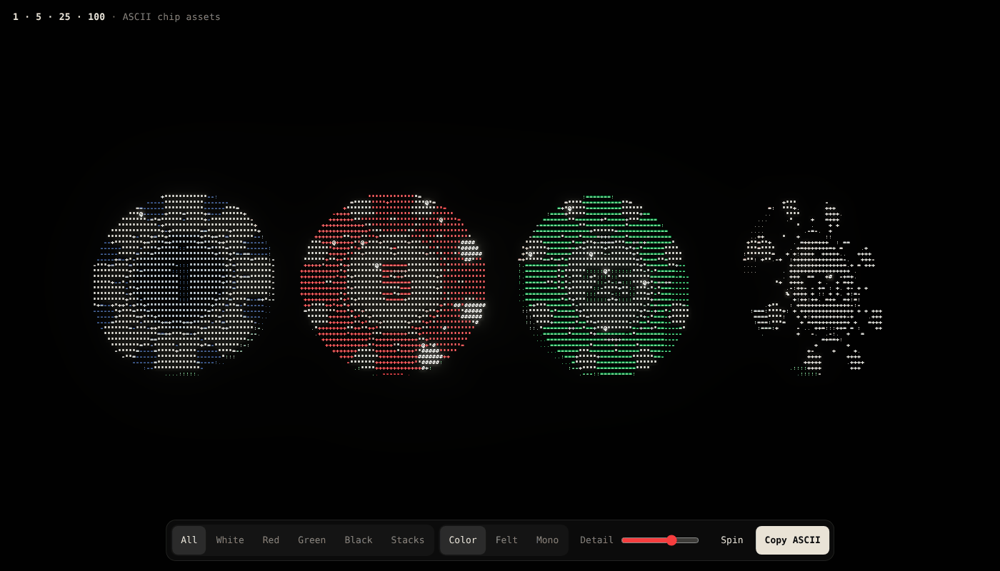

# Web Poker Game: High Stakes in ASCII

A browser poker scene built in three.js and rendered as ASCII art. You're sitting at a round olive felt table in a Vegas casino with A♠ K♠ face down in front of you, and you can peel the corner up to check your hand. I built it with Claude, one prompt at a time, to keep practicing prompt engineering for generative visuals.



## What it does

- **Peek at your hand.** Press on your cards and drag up. Both cards bend together around one corner fold, like a real peek: you see the A, the K and the spades, and the rest of the face stays on the felt. Let go and they drop back flat with a little bounce.
- **A locked 35mm shot.** The camera rests level on the felt at the edge of the table, looking across five graduated chip stacks at the center.
- **Pot and bet sizing.** A gold label over the pot adds up the chips actually on the felt (white $1, red $5, green $25, black $100). A bet slider at the bottom ($0 to $500) builds your bet out of real chips: they drop onto your stack beside your cards as you slide up and lift off as you slide down.
- **A live casino behind you.** About 50 slot machines with spinning reels, chasing marquee bulbs and topper signs. Every few seconds one hits a jackpot and strobes. A progressive jackpot sign keeps counting up at the end of the aisle. No people anywhere.
- **Optional sound.** Synthesized in the browser, no audio files: room hum, slot chimes, reel ticks, coin clinks, and a bell and fanfare panned to whichever machine hits.
- **Copy ASCII.** Copies the current frame as plain text.

| The table | The original 3D scene |
|---|---|
|  |  |

| Card assets | Chip assets |
|---|---|
|  |  |

## Run it

The pages load three.js and a font from CDNs, so serve the folder instead of opening files straight from disk:

```bash
python3 -m http.server 8000
# then open http://localhost:8000/ascii-table/
```

## How it's built

- **three.js r160:** procedural geometry and canvas-drawn textures for everything (cards, chips, felt, slot signs, reel screens). No image files are loaded.
- **ASCII post-processing:** render, then a GPU pass that picks a character per cell from `" .:-=+*#%@"` by brightness and tints it with the scene's color, then bloom. Same pipeline as my FSB logo project.
- **Card peel:** each card is a 2-sided grid mesh bent every frame around a diagonal fold line toward the corner you grabbed, driven by a damped spring so it settles and bounces like card stock.
- **Chips:** instanced cylinders with canvas-drawn faces (edge spots, molded ticks, value inlay) and striped edges, so they read as poker chips and not wafers.
- **Casino:** instanced cabinets, live canvas textures for reels and the jackpot meter, and HDR colors (values over 1) so the bloom picks up bulbs, beacons and neon.

## Project folders

| Folder | What it is |
|---|---|
| `ascii-table/` | The main piece: the table, your cards, the pot and the casino |
| `ascii-cards/` | Card asset bench: A♠, K♠ and the back, turntable view, palettes, detail slider |
| `ascii-chips/` | Chip asset bench: white 1, red 5, green 25, black 100, plus stacks |
| `poker-scene/` | The first build: a realistic (non-ASCII) 3D table with faceless players around it |
| `reference/` | My first Seedream 5.0 Lite attempt at a photo reference for the scene |

## Ideas for what's next

- Play the hand out: an automatic shuffler deals the flop, turn and river, and you squeeze the river with the same peel physics.
- Wire up the bet button so the slider's chips slide into the pot and the pot label counts up.
- Push your chips in with a drag, and an ASCII win moment where the character set swaps to `$ 7 * @` and chips rain down.
- Printed felt (betting line, seat numbers, a center emblem), a lit limit sign, a drink in the rail.
- Casino carpet, eye-in-the-sky ceiling domes, a roulette wheel spinning by itself and a haze layer.

## The prompting process

See [PROMPTS.md](PROMPTS.md) for every prompt I wrote, what came back, and what I learned at each step.
